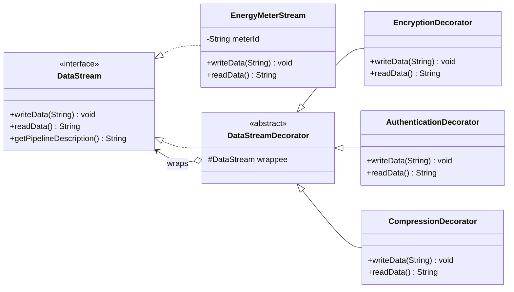
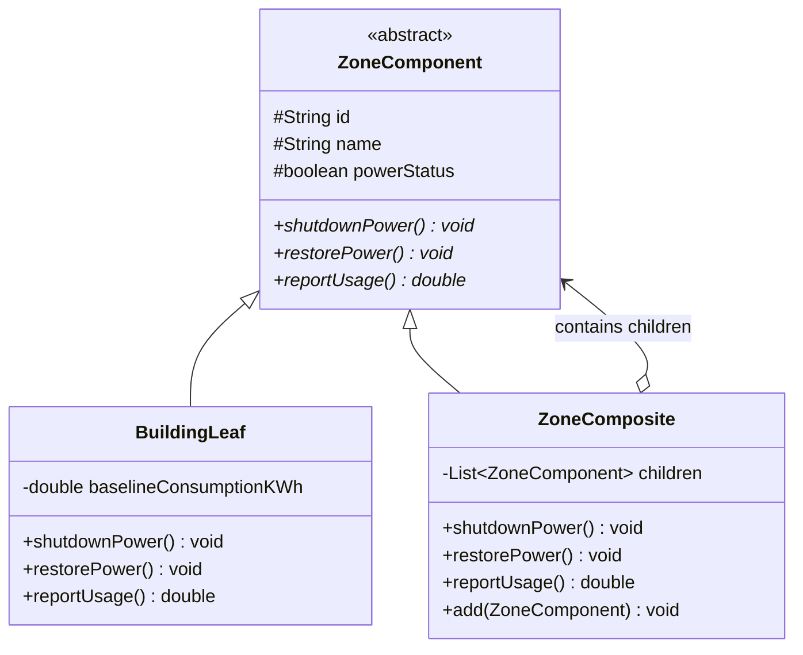
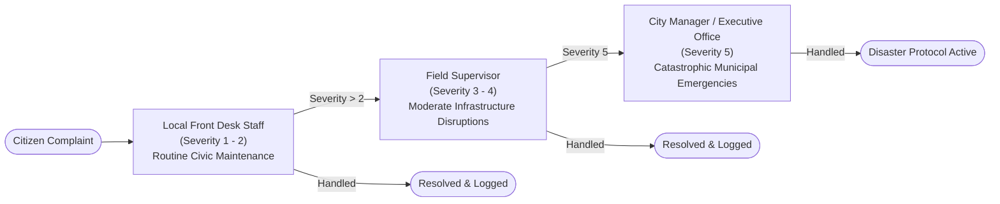

# 🌆 SmartCity360 – Municipal Management Platform
### Enterprise Smart City Infrastructure Engineered with Gang of Four (GoF) Design Patterns

[](https://www.oracle.com/java/)
[](https://spring.io/projects/spring-boot)
[](https://en.wikipedia.org/wiki/Design_Patterns)
[](src/test/java)
[](LICENSE)

---

## 📌 Executive Overview

**SmartCity360** is a comprehensive, production-grade digital municipal platform built to orchestrate and optimize large-scale urban infrastructure. The system integrates real-time energy telemetry streaming, multi-tier electrical grid zoning, civic grievance resolution escalation, large-scale public lighting fleets, and dynamic legislative municipal bylaws evaluation.

Developed as the capstone assessment for **Object Oriented Design Patterns II (`JIAT/OODP II / EX / 01`)** at the **Java Institute for Advanced Technology (JIAT)**, this platform serves as an academic and practical benchmark demonstrating how fundamental Gang of Four (GoF) design patterns resolve critical challenges in distributed systems—such as memory bottlenecks, coupling, and runtime extensibility.

---

## 🏛️ Gang of Four (GoF) Design Patterns Implementation

| Part | Module / Problem Domain | Design Pattern | Classification | Key Architectural Value |
| :---: | :--- | :---: | :---: | :--- |
| **A** | **Dynamic Security Wrappers for Data Streams** | **Decorator** | Structural | Runtime composable AES-256 encryption, HMAC-SHA256 authentication, and GZIP compression over energy meter streams without altering base logic. |
| **B** | **Hierarchical Smart Zone Grid** | **Composite** | Structural | Unified tree representation (`City ➔ District ➔ Street ➔ Building`) allowing uniform polymorphic commands (`shutdownPower`, `restorePower`, `reportUsage`). |
| **C** | **Citizen Complaints Escalation** | **Chain of Responsibility** | Behavioral | Multi-tier grievance routing pipeline (`Local Staff ➔ Field Supervisor ➔ City Manager`) based on ticket severity levels (1 to 5). |
| **D** | **Smart Streetlights Fleet Management** | **Flyweight** | Structural | 95.9% JVM Heap RAM reduction when scaling to **50,000+ streetlights** by sharing immutable intrinsic state (model, wattage, optics) across poles. |
| **E** | **Interpreting City Policies in Mini-Language** | **Interpreter** | Behavioral | Runtime parsing and evaluation of municipal bylaws and safety regulations written in a Domain-Specific Language (DSL) without server reboots. |

---

## 🔬 Architectural Pattern Breakdowns

### 1️⃣ Part A: Dynamic Security Wrappers (`Decorator Pattern`)
* **Problem:** Smart power meters transmit high-frequency telemetry. Depending on the zone sensitivity and network bandwidth, telemetry must be selectively encrypted, authenticated, or compressed without bloating the core stream with conditional spaghetti code.
* **Solution:** A core `EnergyMeterStream` implements the `DataStream` interface. Pluggable decorators (`EncryptionDecorator`, `AuthenticationDecorator`, `CompressionDecorator`) wrap each other dynamically at runtime.



---

### 2️⃣ Part B: Smart Zone Grid Hierarchy (`Composite Pattern`)
* **Problem:** Municipal operators need to dispatch operations like power shutdowns, restoration, or energy audits to an entire city, an entire commercial district, an individual avenue, or a single skyscraper using uniform commands.
* **Solution:** An abstract `ZoneComponent` declares uniform operations (`shutdownPower()`, `restorePower()`, `reportUsage()`). `ZoneComposite` manages child collections and recurses commands down the tree, while `BuildingLeaf` executes terminal actions directly.



---

### 3️⃣ Part C: Citizen Grievances Escalation (`Chain of Responsibility`)
* **Problem:** Citizen complaints range from minor maintenance (potholes, flickering bulbs) to catastrophic municipal emergencies (transformer explosions, bridge cracks). Senders should not be tightly coupled to specific department heads.
* **Solution:** Decoupled escalation chain where each handler evaluates the severity tier. If beyond its operational authority, it smoothly passes the request to the next successor.



---

### 4️⃣ Part D: Smart Streetlights Fleet Optimization (`Flyweight Pattern`)
* **Problem:** A metropolitan area deploys 50,000+ smart streetlights. Instantiating independent objects for each light—with duplicated strings for manufacturers, wattage, optics, and color temperatures—consumes excessive JVM heap memory and triggers frequent garbage collection pauses.
* **Solution:** Partition state into:
  * **Intrinsic State (`StreetLightType`):** Immutable model specifications shared via `StreetLightFactory` (only **3 singleton flyweights** exist in memory).
  * **Extrinsic State (`StreetLight`):** Pole ID, GPS latitude/longitude, power status, and dimming level stored per physical pole.

#### 📊 Empirical Memory Profiling Benchmark (50,000 Streetlights)

| Metric | Without Flyweight (Unoptimized) | With Flyweight Pattern | Optimization Gain |
| :--- | :---: | :---: | :---: |
| **Flyweight Model Objects** | 50,000 redundant objects | **3 shared singletons** | **99.99% reduction** |
| **Average Per-Instance RAM** | ~920 bytes | ~38 bytes | **24.2x memory savings** |
| **Total JVM Heap Footprint** | **43.9 MB** | **1.81 MB** | 🚀 **95.9% RAM Reduction** |

---

### 5️⃣ Part E: City Operational Policy Evaluator (`Interpreter Pattern`)
* **Problem:** Civic regulations and environmental bylaws (noise limits, zone operating hours, speed limits) change frequently. Hardcoding these rules into Java business classes requires recompilation, redeployment, and downtime.
* **Solution:** A Domain-Specific Language (DSL) parsed by `PolicyDslParser` into an Abstract Syntax Tree (AST) of `Expression` nodes evaluated against a runtime `CityPolicyContext`.

**Supported DSL Features:**
* Logical operators with precedence: `NOT` > `AND` > `OR`
* Parentheses grouping: `(ZONE == "SCHOOL_ZONE" OR ZONE == "RESIDENTIAL") AND SPEED_LIMIT_KMH <= 40`
* Relational operators: `==`, `!=`, `<`, `<=`, `>`, `>=`

---

## 💻 Tech Stack & Architecture

* **Backend Runtime:** Java 17 (LTS), Spring Boot 3.3.5
* **Design Patterns:** Pure Java GoF implementation in package `lk.jiat.oodpii.smartcity360.patterns.*`
* **Web Layer:** Spring MVC REST Controllers (`/api/stream`, `/api/zones`, `/api/complaints`, `/api/fleet`, `/api/policy`)
* **Testing:** JUnit 5, Spring Boot Test, Maven Surefire
* **Frontend UI:** Modern minimalist light theme (`#f4f5f8` background, `#74c043` lime accents, borderless cards, SVG telemetry chart, HTML5 metropolis road network canvas)

---

## 📂 Project Structure

```
SmartCity360/
├── docs/
│   ├── OODP_II_Final_Assessment.pdf      # Official Assessment Specification
│   └── PROJECT_DOCUMENTATION.md           # Comprehensive Academic Report & VIVA Q&A
├── src/
│   ├── main/
│   │   ├── java/lk/jiat/oodpii/smartcity360/
│   │   │   ├── SmartCity360Application.java
│   │   │   ├── controller/
│   │   │   │   ├── TelemetryController.java      # Part A REST API (/api/stream)
│   │   │   │   ├── ZoneController.java           # Part B REST API (/api/zones)
│   │   │   │   ├── ComplaintController.java      # Part C REST API (/api/complaints)
│   │   │   │   ├── FleetController.java          # Part D REST API (/api/fleet)
│   │   │   │   └── PolicyController.java         # Part E REST API (/api/policy)
│   │   │   └── patterns/
│   │   │       ├── decorator/                    # Part A Decorator Pattern
│   │   │       ├── composite/                    # Part B Composite Pattern
│   │   │       ├── chain/                        # Part C Chain of Responsibility
│   │   │       ├── flyweight/                    # Part D Flyweight Pattern
│   │   │       └── interpreter/                  # Part E Interpreter Pattern
│   │   └── resources/
│   │       ├── application.properties
│   │       └── static/                           # Minimalist Light Mode Dashboard
│   │           ├── index.html
│   │           ├── css/app.css
│   │           └── js/app.js
│   └── test/java/lk/jiat/oodpii/smartcity360/
│       ├── SmartCity360ApplicationTests.java
│       └── patterns/
│           ├── DecoratorPatternTest.java          # 4 unit tests
│           ├── CompositePatternTest.java          # 4 unit tests
│           ├── ChainOfResponsibilityTest.java     # 6 unit tests
│           ├── FlyweightPatternTest.java          # 3 unit tests
│           └── InterpreterPatternTest.java        # 4 unit tests
├── pom.xml
└── README.md
```

---

## 🚀 Getting Started

### Prerequisites
* **Java Development Kit (JDK):** Version 17 or higher
* **Apache Maven:** Version 3.8+ (or use the included `./mvnw` wrapper)
* **Web Browser:** Any modern browser (Chrome, Firefox, Edge, Safari)

### 1. Clone the Repository
```bash
git clone https://github.com/lakshithamadumal/SmartCity360.git
cd SmartCity360
```

### 2. Run All Automated Unit Tests
To execute all 22 tests across all 5 design patterns:
```bash
./mvnw clean test
```
*Expected Result:*
```
[INFO] Running lk.jiat.oodpii.smartcity360.patterns.ChainOfResponsibilityTest
[INFO] Tests run: 6, Failures: 0, Errors: 0, Skipped: 0
[INFO] Running lk.jiat.oodpii.smartcity360.patterns.CompositePatternTest
[INFO] Tests run: 4, Failures: 0, Errors: 0, Skipped: 0
[INFO] Running lk.jiat.oodpii.smartcity360.patterns.DecoratorPatternTest
[INFO] Tests run: 4, Failures: 0, Errors: 0, Skipped: 0
[INFO] Running lk.jiat.oodpii.smartcity360.patterns.FlyweightPatternTest
[INFO] Tests run: 3, Failures: 0, Errors: 0, Skipped: 0
[INFO] Running lk.jiat.oodpii.smartcity360.patterns.InterpreterPatternTest
[INFO] Tests run: 4, Failures: 0, Errors: 0, Skipped: 0
[INFO] ------------------------------------------------------------------------
[INFO] BUILD SUCCESS (22/22 Tests Passing)
[INFO] ------------------------------------------------------------------------
```

### 3. Launch the Application
```bash
./mvnw spring-boot:run
```
Once started, navigate to:
👉 **`http://localhost:8080`** to access the interactive web dashboard!

---

## 📡 REST API Reference

### 1. Telemetry Security Wrappers (`Decorator`)
* **Endpoint:** `POST /api/stream/secure`
```json
{
  "meterId": "GRID-MTR-9042",
  "rawPayload": "{\"voltage_V\":231.1,\"current_A\":15.06,\"total_kwh\":12488.4}",
  "encrypt": true,
  "authenticate": true,
  "compress": true
}
```

### 2. Grid Power Command (`Composite`)
* **Endpoint:** `POST /api/zones/command`
```json
{
  "targetId": "DIST-COMM",
  "command": "SHUTDOWN"
}
```

### 3. Citizen Complaint Dispatch (`Chain of Responsibility`)
* **Endpoint:** `POST /api/complaints/dispatch`
```json
{
  "citizenName": "Kasun Perera",
  "category": "Civil Infrastructure",
  "description": "Deep road depression on 3rd Avenue",
  "severity": 2
}
```

### 4. Fleet RAM Profiler (`Flyweight`)
* **Endpoint:** `GET /api/fleet/profile?count=50000`

### 5. Policy DSL Evaluation (`Interpreter`)
* **Endpoint:** `POST /api/policy/evaluate`
```json
{
  "dsl": "ZONE == \"COMMERCIAL\" AND NOISE_DB <= 75",
  "telemetry": {
    "ZONE": "COMMERCIAL",
    "NOISE_DB": 68.5
  }
}
```

---

## 📑 Academic Documentation & VIVA Preparation

For complete technical specifications, in-depth architectural trade-offs, and expected VIVA examiner questions with sample model answers, please refer to:  
👉 **[`docs/PROJECT_DOCUMENTATION.md`](docs/PROJECT_DOCUMENTATION.md)**

---

## 👨‍💻 Author & Acknowledgements

* **Author:** Lakshitha Madumal ([@lakshithamadumal](https://github.com/lakshithamadumal))
* **Institution:** Java Institute for Advanced Technology (JIAT)
* **Unit:** Object Oriented Design Patterns II (`JIAT/OODP II / EX / 01`)

---
*Developed with pure Java and Spring Boot for sustainable smart cities of tomorrow.* 🌿🏙️
